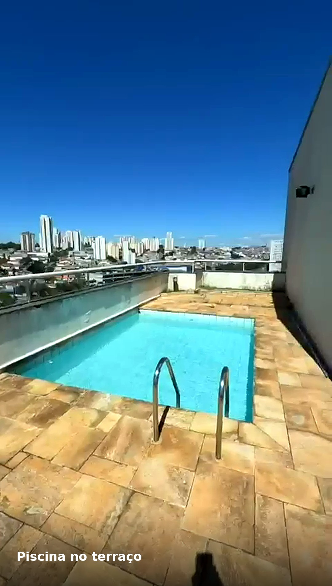
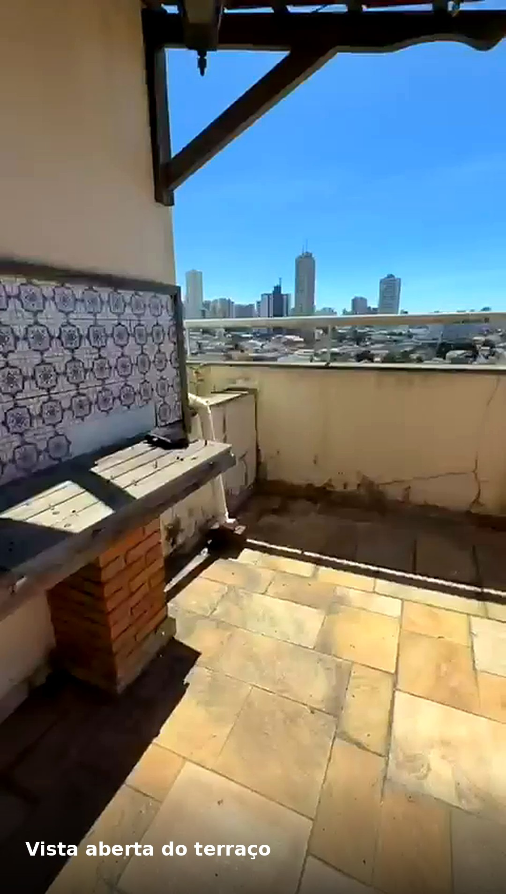
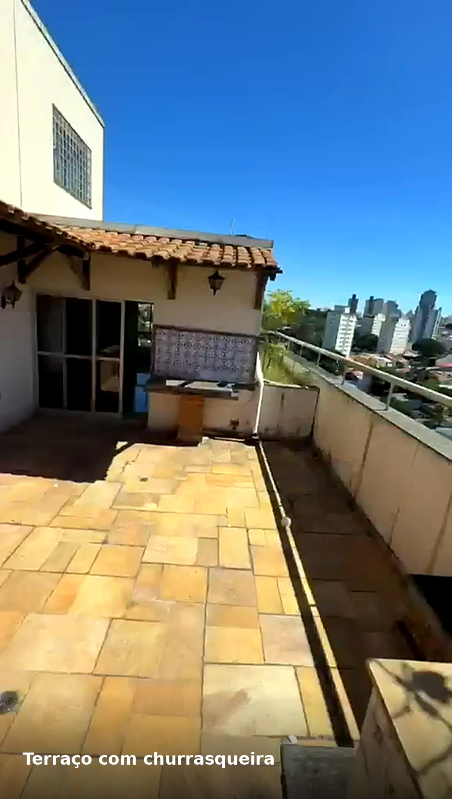
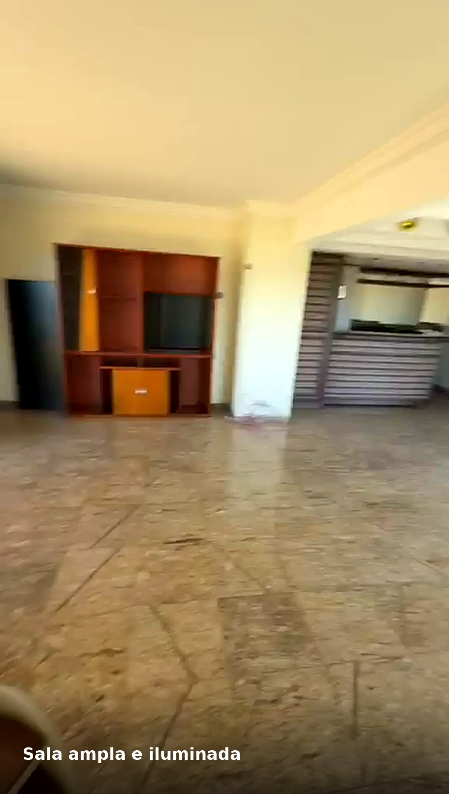
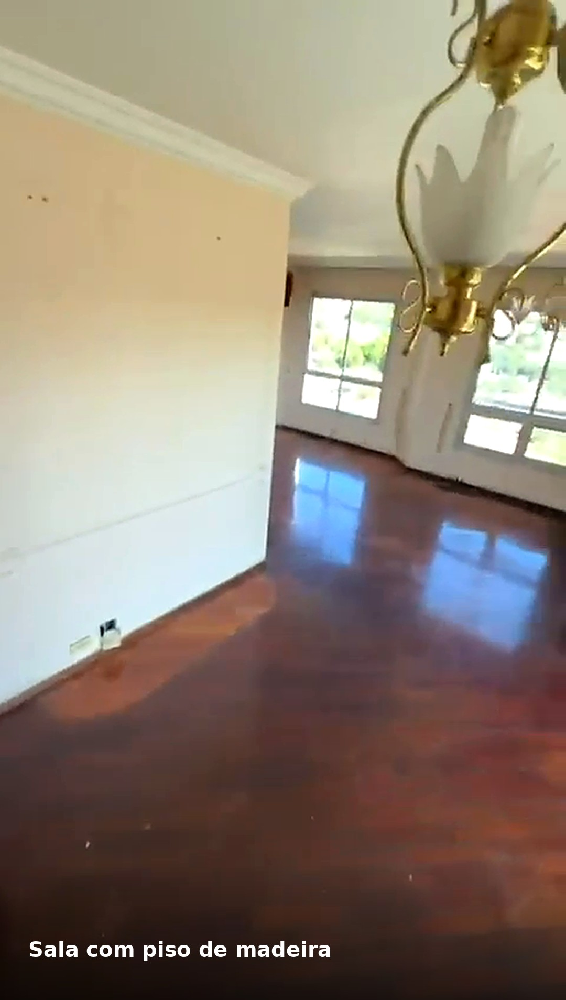
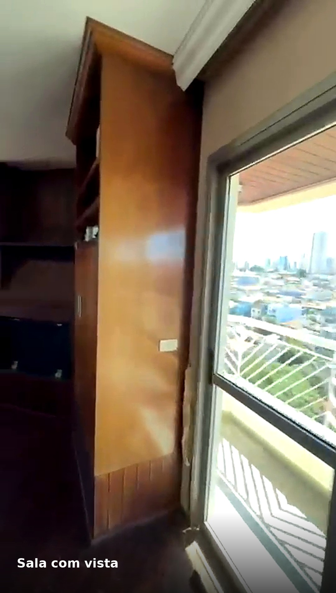
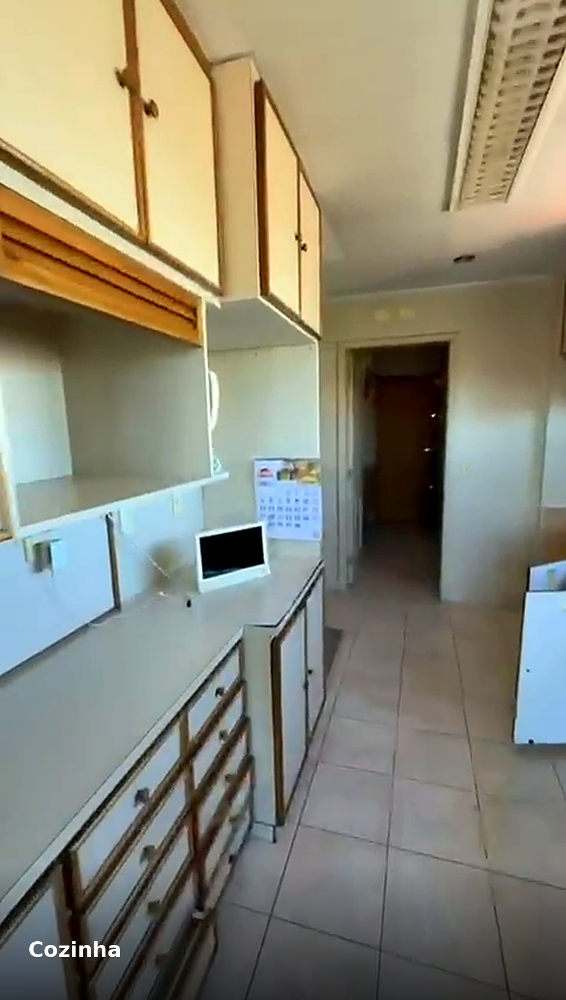
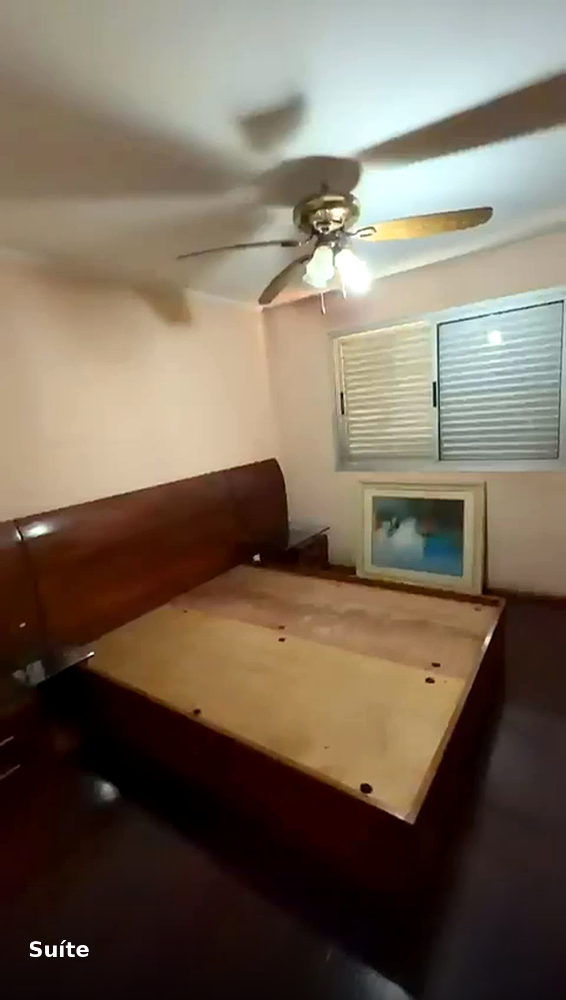
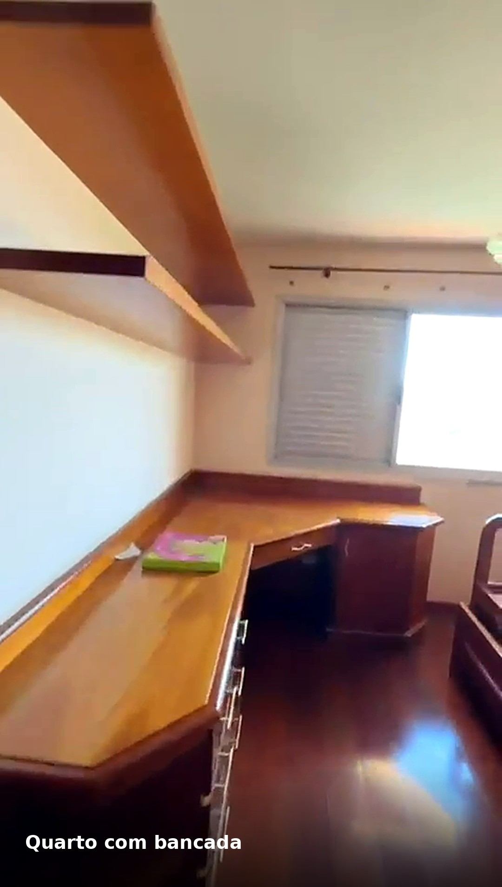

# Duplex de 260 m² com piscina no terraço

**Saúde, zona sul de São Paulo · unidade única · R$ 840 mil**

Dois andares, terraço com piscina, churrasqueira e vista aberta, 2 vagas. Fotos e vídeo reais do imóvel, no estado atual.

**[▶ Assistir ao vídeo do imóvel](https://github.com/carloshenriquenunesdossantos-bot/henriqueenofc-media/blob/main/duplex-saude/video-duplex.mp4)**

**[Falar com o Carlos no WhatsApp](https://wa.me/5511990073735?text=Oi%20Carlos%2C%20vi%20as%20fotos%20do%20duplex%20da%20Sa%C3%BAde%20e%20quero%20saber%20mais.)**

## Terraço

## Salas

## Cozinha e quartos

---

Imóvel para reformar, construção de 1990. A reforma fica fora do valor de compra: estimativa de R$ 150 mil (pronto para vender) a R$ 650 mil (mobiliado). Visita no dia que você quiser, é só combinar o horário.
